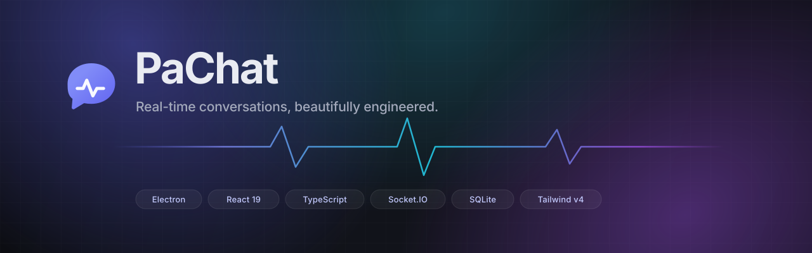
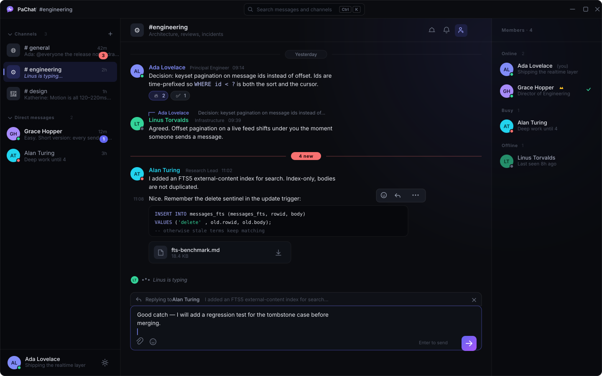
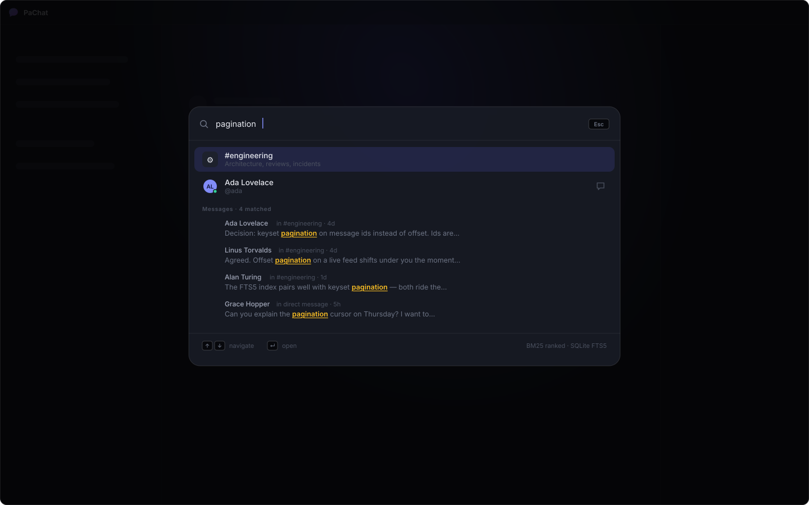
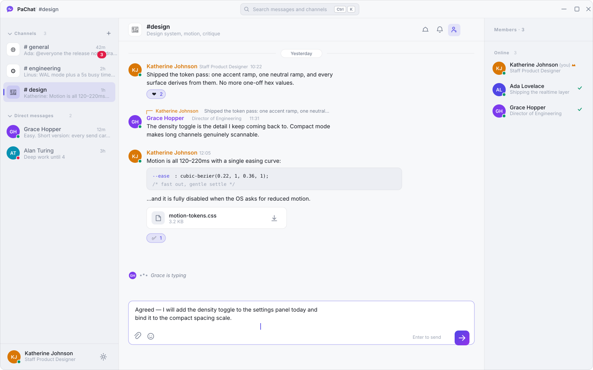
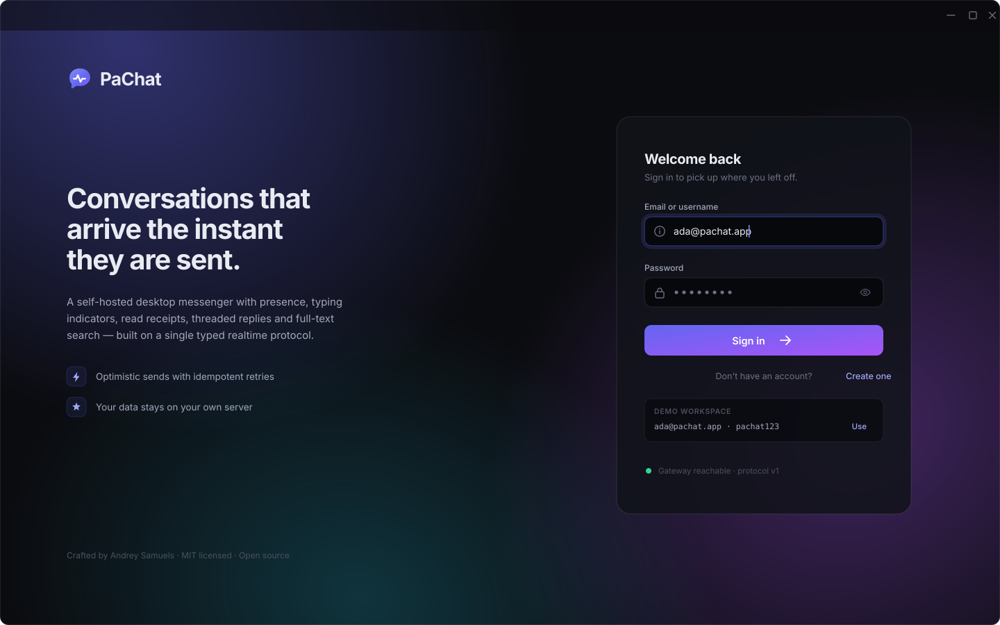
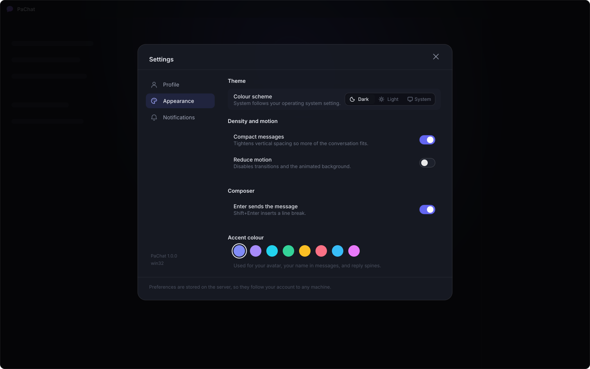
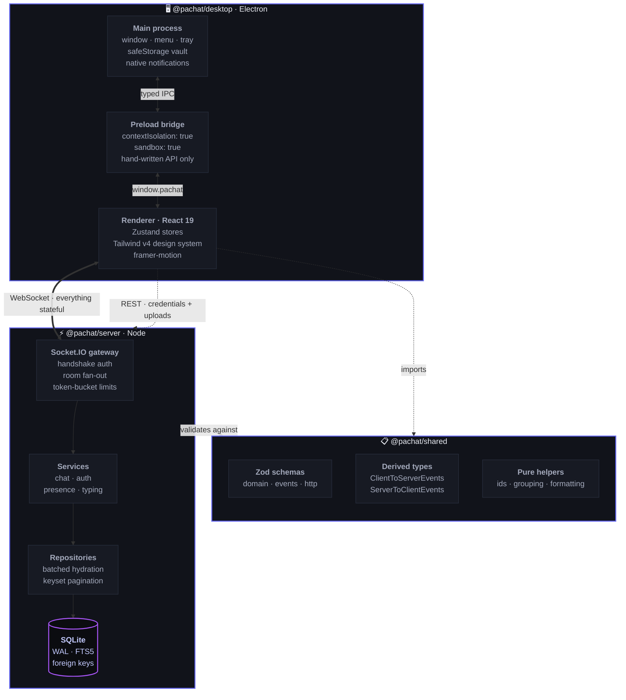
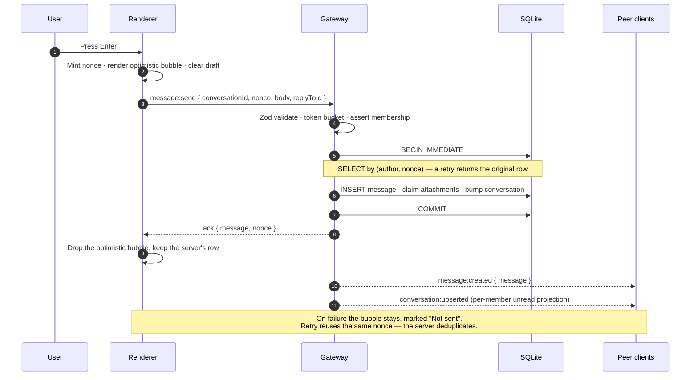

<div align="center">



<br />

**A premium, self-hosted real-time chat application for the desktop.**

Presence, typing indicators, read receipts, threaded replies, reactions, file
sharing and full-text search — over a single, strictly typed realtime protocol.

<br />

[](https://www.electronjs.org/)
[](https://react.dev/)
[](https://www.typescriptlang.org/)
[](https://socket.io/)
[](https://tailwindcss.com/)
[](https://www.sqlite.org/fts5.html)

[](LICENSE)
[](#-installation)
[](CONTRIBUTING.md)

<br />

[**Showcase**](#-showcase) · [**Quick start**](#-quick-start) · [**Features**](#-features) · [**Architecture**](#-architecture) · [**Design system**](docs/DESIGN.md) · [**Protocol**](docs/API.md) · [**Roadmap**](docs/ROADMAP.md)

</div>

<br />

---

<br />

## 🖼 Showcase

<div align="center">



<br />
<br />

**The workspace** — everything below is one screen, rendered by the real client

</div>

<table>
<tr>
<td width="25%" valign="top"><b>Message log</b><br /><sub>Grouped messages, day separators, a frozen unread divider, threaded reply with the author's accent on the spine.</sub></td>
<td width="25%" valign="top"><b>Live signals</b><br /><sub>Presence rings on avatars, a typing indicator that reserves no space when idle, read receipts in the member list.</sub></td>
<td width="25%" valign="top"><b>Rich content</b><br /><sub>Inline and fenced code, links, <code>@mentions</code>, reactions with your own highlighted, attachments at reserved dimensions.</sub></td>
<td width="25%" valign="top"><b>Desktop chrome</b><br /><sub>Frameless titlebar drawn in React, search affordance with platform-correct shortcut chips, native window controls.</sub></td>
</tr>
</table>

<br />

<table>
<tr>
<td width="50%" align="center">

<br />
<b>Command palette</b> · <kbd>Ctrl/⌘</kbd> <kbd>K</kbd>
<br />
<sub>Conversations and members filter locally and instantly; message bodies come back BM25-ranked from SQLite FTS5 with matched terms highlighted.</sub>
</td>
<td width="50%" align="center">

<br />
<b>Light theme</b>
<br />
<sub>Not a filter — a second complete token ramp. Flipping <code>data-theme</code> re-themes the app and repaints the native window frame with no re-render.</sub>
</td>
</tr>
<tr><td colspan="2"><br /></td></tr>
<tr>
<td width="50%" align="center">

<br />
<b>Sign-in</b>
<br />
<sub>Transform-only aurora background that runs on the compositor and freezes under <code>prefers-reduced-motion</code>. Seeded credentials are one click away in development.</sub>
</td>
<td width="50%" align="center">

<br />
<b>Settings</b>
<br />
<sub>Preferences are stored server-side, so they follow the account to any machine — and every toggle applies optimistically before the round-trip confirms it.</sub>
</td>
</tr>
</table>

<br />

> **Want to see it move?** `npm run setup && npm run dev` puts you in a populated
> workspace in under a minute. Launch a second client with `npm run dev:desktop`,
> sign in as a different member, and watch presence, typing, messages, reactions
> and read receipts land live in both windows.

<br />

---

<br />

## Why PaChat

Most chat apps are either a thin wrapper around a hosted service or a toy demo
that stops at "messages appear". PaChat is neither. It is a complete product
built to answer a specific question:

> **What does a real-time messenger look like when the hard parts are actually
> solved — and the result still feels like a premium desktop app?**

The hard parts, concretely:

|                             | The problem                                                     | How PaChat solves it                                                                                                          |
| :-------------------------- | :-------------------------------------------------------------- | :---------------------------------------------------------------------------------------------------------------------------- |
| **Duplicate sends**         | A retry after a flaky reconnect posts the message twice.        | Every send carries a client-generated **nonce** under a unique `(author, nonce)` index. A retry resolves to the original row. |
| **Lost drafts**             | Switching channels mid-sentence throws the text away.           | Drafts are held **per conversation** in the store, not in component state.                                                    |
| **Scroll jumping**          | A new message yanks you out of the history you were reading.    | Sticky scroll follows new content **only when you are already at the bottom**.                                                |
| **Shifting pagination**     | `OFFSET` pages shift under you as messages arrive.              | **Keyset pagination** over time-prefixed ids: `WHERE id < ?` is both filter and sort.                                         |
| **Ghost typing indicators** | A client disconnects mid-keystroke; the indicator runs forever. | Each indicator carries its own TTL and is swept by a single process-wide janitor.                                             |
| **Presence flapping**       | Every reload flashes the whole workspace offline.               | Presence is **derived from live sockets** with a grace period, and counts sockets per member for multi-window.                |
| **Notification spam**       | A busy channel becomes an unusable stream of toasts.            | Four conditions must _all_ hold before the OS is notified — including "not already reading it in a focused window".           |
| **Protocol drift**          | The client and server disagree after a deploy.                  | One shared package declares every payload. A breaking change **cannot compile on only one side**.                             |

<br />

## ✨ Features

<table>
<tr>
<td width="50%" valign="top">

### Messaging

- **Optimistic sends** with idempotent retries and inline failure recovery
- **Threaded replies** with an inline quote that scrolls to its parent
- **Edit & delete** with a 24-hour edit window and tombstoned history
- **Emoji reactions**, aggregated server-side and broadcast as whole state
- **Message grouping** — consecutive messages collapse into one block
- **Day separators** and a frozen **"new messages"** divider
- **Inline markup** — bold, italic, strike, inline & fenced code, quotes, links
- **@mentions** that resolve to display names and highlight when they're you

</td>
<td width="50%" valign="top">

### Real time

- **Live presence** — online, away, busy, offline + custom status lines
- **Typing indicators** with leading-edge broadcast and TTL expiry
- **Read receipts** surfaced as "who has caught up" in the member list
- **Unread counts** and **mention badges**, per member and per conversation
- **Multi-device sync** — every window of an account stays in lockstep
- **Automatic reconnection** with backoff, jitter and connection-state recovery
- **Silent token refresh** so the app survives being left open overnight

</td>
</tr>
<tr>
<td width="50%" valign="top">

### Workspace

- **Public & private channels** with owner/admin/member roles
- **Direct messages**, idempotent at the database level
- **Full-text search** over message bodies via **SQLite FTS5** with BM25 ranking
- **Command palette** (`Ctrl/⌘ K`) for navigation, people and message search
- **Pin** and **mute** per conversation, private to each member
- **File attachments** up to 25 MiB with inline image previews
- **Member directory** grouped by presence

</td>
<td width="50%" valign="top">

### Desktop craft

- **Frameless custom titlebar** with native macOS traffic lights
- **Native notifications** that focus the right conversation on click
- **Taskbar / dock badge** reflecting the unread total
- **OS-encrypted credentials** via `safeStorage` (DPAPI / Keychain / libsecret)
- **Window geometry** restored, and validated against the current displays
- **Single-instance** enforcement — a second launch raises the first window
- **Dark & light themes**, compact density, and full reduced-motion support
- **Full keyboard control** with a native application menu

</td>
</tr>
</table>

<br />

## 🚀 Quick start

> **Requirements** — Node.js **20.11+** (22 LTS recommended) and npm 10+.
> Nothing else: no Docker, no database server, no cloud account.

```bash
# 1 · Clone
git clone https://github.com/andreysamuels0001/pachat.git
cd pachat

# 2 · Install
npm install

# 3 · Provision — generates signing secrets, migrates the schema,
#     and seeds a populated demo workspace
npm run setup

# 4 · Run the gateway and the desktop client together
npm run dev
```

The Electron window opens on the sign-in screen. Use any seeded account:

| Email                  | Password    | Role                    |
| :--------------------- | :---------- | :---------------------- |
| `ada@pachat.app`       | `pachat123` | Principal Engineer      |
| `grace@pachat.app`     | `pachat123` | Director of Engineering |
| `alan@pachat.app`      | `pachat123` | Research Lead           |
| `katherine@pachat.app` | `pachat123` | Staff Product Designer  |
| `linus@pachat.app`     | `pachat123` | Infrastructure          |

> 💡 **See real-time actually working:** sign in as `ada@pachat.app`, then launch a
> second client with `npm run dev:desktop` in another terminal and sign in as
> `grace@pachat.app`. Type in one window and watch presence, typing indicators,
> messages, reactions and read receipts land in the other.

<br />

## 📦 Installation

Build native installers for the current platform:

```bash
npm run package         # unpacked build in apps/desktop/release — fast smoke test
npm run dist            # installers for the host platform
```

| Platform | Output                               | Target                       |
| :------- | :----------------------------------- | :--------------------------- |
| Windows  | `PaChat-1.0.0-win-x64.exe`           | NSIS installer (x64 + arm64) |
| macOS    | `PaChat-1.0.0-mac-arm64.dmg`         | DMG (Intel + Apple Silicon)  |
| Linux    | `PaChat-1.0.0-linux-x86_64.AppImage` | AppImage + `.deb`            |

Point a packaged client at a remote gateway with the `PACHAT_SERVER_URL`
environment variable; it defaults to `http://127.0.0.1:4000`.

<br />

## 🏗 Architecture

Three packages, one contract.



### The shape of a message send



### Why these choices

<details>
<summary><b>SQLite, not Postgres</b></summary>

<br />

PaChat is a single-node, self-hosted service. An in-process store removes an
entire deployment tier, connection pooling, and all network latency from every
query. What makes it suitable for a concurrent realtime workload is the pragma
configuration, not the default one:

- **`journal_mode = WAL`** — readers proceed during writes, which matters when
  every inbound message writes while the UI pages history.
- **`synchronous = NORMAL`** — fsync at checkpoints rather than per
  transaction. A crash can lose the last few milliseconds, never the database.
- **`foreign_keys = ON`** — off by default in SQLite; PaChat relies on
  `ON DELETE CASCADE` to clean up members, reactions and attachments.
- **`busy_timeout = 5000`** — wait under contention instead of throwing
  `SQLITE_BUSY`.
- **FTS5 external-content index** — real BM25-ranked search without
  duplicating message bodies.

</details>

<details>
<summary><b>Time-prefixed ids, not UUIDs</b></summary>

<br />

Every id is a 24-character, URL-safe string: an 8-character base36 timestamp
followed by 16 characters of CSPRNG randomness.

Sorting by id therefore sorts by creation time. That single property means
message history pages with a plain `WHERE conversation_id = ? AND id < ?`,
served entirely by one `(conversation_id, id DESC)` index — no compound
cursor, no tie-breaking on identical millisecond timestamps, and no `OFFSET`
drift while new messages arrive mid-scroll.

</details>

<details>
<summary><b>Two tokens, one opaque</b></summary>

<br />

The **access token** is a short-lived HS256 JWT. It is what the socket
handshake carries, so the gateway authenticates a connection without touching
the database.

The **refresh token** is opaque, long-lived, and stored only as a SHA-256
digest — a leaked table cannot be replayed into live sessions. It rotates on
every use, so a stolen token is usable at most once before the legitimate
client invalidates it, and theft surfaces as an unexpected sign-out rather than
silent indefinite access.

Logout takes effect **immediately** rather than at token expiry: every
handshake re-checks that the session row is still live.

</details>

<details>
<summary><b>A renderer with no privileges</b></summary>

<br />

The Electron renderer runs with `contextIsolation: true`,
`nodeIntegration: false` and `sandbox: true`. It has no filesystem, no
`require`, and no direct Electron access.

Every privileged capability it has is a named channel in
[`shared-ipc/contract.ts`](apps/desktop/src/shared-ipc/contract.ts), exposed
through a hand-written preload bridge — never `ipcRenderer` itself, which
would let the renderer address any channel in the main process and defeat the
point of isolation. A strict CSP is injected at the session layer, and all
navigation away from the bundle is routed to the OS browser.

</details>

<details>
<summary><b>Message bodies are React nodes, never HTML</b></summary>

<br />

Author-supplied text is parsed into real React elements by
[`lib/markup.tsx`](apps/desktop/src/renderer/src/lib/markup.tsx) — not into an
HTML string handed to `dangerouslySetInnerHTML`.

This means escaping is not something that _can_ be forgotten: no message body
is ever interpreted as markup, so there is no path from a message to injected
HTML at all.

</details>

<br />

## 📁 Project structure

```
pachat/
├── packages/
│   └── shared/                      @pachat/shared — the contract layer
│       └── src/
│           ├── domain.ts            Zod schemas: users, conversations, messages
│           ├── events.ts            Typed Socket.IO surface + ack envelope
│           ├── http.ts              REST routes and payloads
│           ├── constants.ts         Limits, timings, protocol version
│           └── utils.ts             Ids, grouping, formatting, mentions
│
├── apps/
│   ├── server/                      @pachat/server — the realtime gateway
│   │   └── src/
│   │       ├── main.ts              Boot, housekeeping, graceful shutdown
│   │       ├── config/env.ts        Validated configuration
│   │       ├── db/                  Connection, migrations, CLI, demo seed
│   │       ├── lib/                 Logger, errors, tokens, limiters, image sniff
│   │       ├── repositories/        Batched hydration, keyset pagination, FTS
│   │       ├── services/            Chat, auth, presence, typing
│   │       ├── http/                Express app, middleware, routes
│   │       └── realtime/gateway.ts  Handshake, rooms, fan-out
│   │
│   └── desktop/                     @pachat/desktop — the Electron client
│       └── src/
│           ├── shared-ipc/          The privileged IPC contract
│           ├── main/                Window, menu, secure vault, IPC handlers
│           ├── preload/             The context bridge
│           └── renderer/src/
│               ├── styles/          Design tokens + Tailwind v4 theme
│               ├── lib/             API, socket, markup, hooks, bridge
│               ├── store/           Zustand stores + the realtime binding
│               ├── components/      UI primitives, brand, window chrome
│               └── features/        auth · chat · settings
│
├── docs/                            Architecture, design system, protocol
└── scripts/                         setup.mjs · clean.mjs
```

<br />

## 🛠 Commands

| Command                     | What it does                                                  |
| :-------------------------- | :------------------------------------------------------------ |
| `npm run setup`             | Generate secrets, migrate the schema, seed the demo workspace |
| `npm run dev`               | Gateway + desktop client, both watching                       |
| `npm run dev:server`        | Gateway only                                                  |
| `npm run dev:desktop`       | Desktop client only (useful for a second window)              |
| `npm run build`             | Type-check and build all three packages                       |
| `npm run typecheck`         | Type-check every workspace                                    |
| `npm run lint` · `lint:fix` | ESLint 9 flat config across the monorepo                      |
| `npm run format`            | Prettier across every source file                             |
| `npm run db:migrate`        | Apply pending migrations                                      |
| `npm run db:seed`           | Insert the demo workspace (no-op if users exist)              |
| `npm run db:reset`          | Drop everything, then migrate and seed                        |
| `npm run package`           | Unpacked desktop build                                        |
| `npm run dist`              | Platform installers                                           |
| `npm run clean`             | Remove build output (`-- --deps` also drops `node_modules`)   |

<br />

## ⌨️ Keyboard

| Shortcut                                                     | Action                                                  |
| :----------------------------------------------------------- | :------------------------------------------------------ |
| <kbd>Ctrl/⌘</kbd> <kbd>K</kbd>                               | Command palette — conversations, people, message search |
| <kbd>Ctrl/⌘</kbd> <kbd>Shift</kbd> <kbd>N</kbd>              | New channel                                             |
| <kbd>Ctrl/⌘</kbd> <kbd>,</kbd>                               | Settings                                                |
| <kbd>Ctrl/⌘</kbd> <kbd>Shift</kbd> <kbd>M</kbd>              | Toggle the member list                                  |
| <kbd>Ctrl/⌘</kbd> <kbd>Shift</kbd> <kbd>E</kbd>              | Mark everything read                                    |
| <kbd>Ctrl/⌘</kbd> <kbd>Alt</kbd> <kbd>↑</kbd> / <kbd>↓</kbd> | Previous / next conversation                            |
| <kbd>Enter</kbd>                                             | Send (configurable to <kbd>Ctrl</kbd> <kbd>Enter</kbd>) |
| <kbd>Shift</kbd> <kbd>Enter</kbd>                            | Line break                                              |
| <kbd>Esc</kbd>                                               | Close the overlay, cancel a reply or an edit            |

<br />

## ⚙️ Configuration

The gateway reads `apps/server/.env` — see
[`.env.example`](apps/server/.env.example) for the annotated template.

| Variable                  | Default                 | Purpose                                       |
| :------------------------ | :---------------------- | :-------------------------------------------- |
| `PORT` · `HOST`           | `4000` · `127.0.0.1`    | Listener address                              |
| `NODE_ENV`                | `development`           | Switches log format and secret validation     |
| `CORS_ORIGINS`            | `http://localhost:5173` | Allowed browser origins (comma-separated)     |
| `JWT_ACCESS_SECRET`       | —                       | **Required.** Access-token signing key        |
| `JWT_REFRESH_SECRET`      | —                       | **Required.** Refresh-token signing key       |
| `DATA_DIR` · `UPLOAD_DIR` | `./data`                | Database and attachment storage               |
| `LOG_LEVEL`               | `info`                  | `trace` · `debug` · `info` · `warn` · `error` |
| `ALLOW_REGISTRATION`      | `true`                  | Self-service account creation                 |
| `AUTH_RATE_LIMIT`         | `20`                    | Auth requests per minute per IP               |

A production boot **refuses to start** if the JWT secrets are still the
placeholders from `.env.example` — the single most common way a self-hosted
chat server ends up trivially impersonatable.

<br />

## 🔒 Security

| Area          | Measure                                                                                                          |
| :------------ | :--------------------------------------------------------------------------------------------------------------- |
| Passwords     | bcrypt, cost 12, plus a decoy hash so a failed login costs the same whether or not the account exists            |
| Sessions      | Rotating opaque refresh tokens, stored as SHA-256 digests; per-device revocation                                 |
| Transport     | Protocol-versioned handshake; a stale build is refused rather than allowed to corrupt state                      |
| Authorisation | One membership gate (`assertMember`) that every conversation handler passes through                              |
| Attachments   | Opaque storage keys, authenticated downloads, `nosniff`, sanitised filenames never used as paths                 |
| Abuse         | Per-IP fixed-window limiting on auth; per-member token buckets on sends, reactions and typing                    |
| Renderer      | Sandboxed, context-isolated, no Node, strict CSP, hand-written IPC allow-list                                    |
| Credentials   | OS keychain via `safeStorage`; refused rather than downgraded to plaintext when unavailable                      |
| Search        | Membership subquery is the authorisation boundary — no code path returns a message from a channel you are not in |

Found something? See [SECURITY.md](SECURITY.md).

<br />

## 📚 Documentation

| Document                                    | Contents                                                         |
| :------------------------------------------ | :--------------------------------------------------------------- |
| [**ARCHITECTURE.md**](docs/ARCHITECTURE.md) | Layering, data flow, state ownership, failure handling           |
| [**DESIGN.md**](docs/DESIGN.md)             | The design system: tokens, type scale, motion, component anatomy |
| [**API.md**](docs/API.md)                   | REST endpoints and the complete realtime event protocol          |
| [**ROADMAP.md**](docs/ROADMAP.md)           | What is next and what is deliberately out of scope               |
| [**CONTRIBUTING.md**](CONTRIBUTING.md)      | Local setup, conventions, PR expectations                        |
| [**CHANGELOG.md**](CHANGELOG.md)            | Release history                                                  |

<br />

## 🗺 Roadmap

- [x] Real-time messaging with optimistic, idempotent sends
- [x] Presence, typing indicators and read receipts
- [x] Channels, direct messages, reactions and threaded replies
- [x] Full-text search with BM25 ranking
- [x] File attachments with inline previews
- [x] Dark & light themes, compact density, reduced motion
- [x] Native notifications, badge and secure credential storage
- [ ] Voice notes and inline audio playback
- [ ] End-to-end encryption for direct messages
- [ ] Message threads as first-class side panels
- [ ] Custom emoji and per-workspace branding
- [ ] Mobile companion client

Full detail and non-goals in [docs/ROADMAP.md](docs/ROADMAP.md).

<br />
